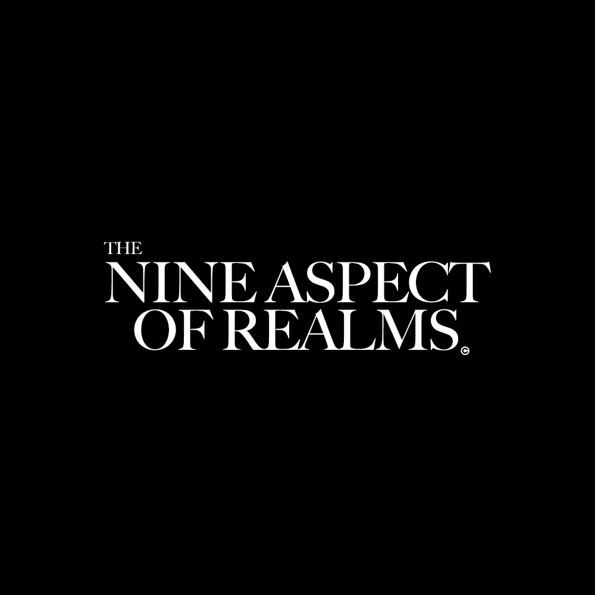

  

# NAOR: The Nine Aspect of Realms

A 2D pixel-art action platformer developed in Unity by the **OTK** student game development team.
You explore realms full of traps and enemies, fight with sword combos, daggers and bombs, and use
soul-based abilities to get through.

## Features

- **Fluid movement:** dash, glide, swing, crouch, and wall grab, slide, climb and jump
- **Melee combat:** a 3-hit basic combo, charge attack and plunge attack, plus throwable daggers and bombs
- **Soul and mana system:** collect souls from enemies and spend mana on abilities like Soul Walk
- **Enemies:** sword, shield and archer enemies, and a necromancer that raises creatures
- **World:** NPC dialogue and fetch quests, inventory and items, currency, portals, elevators,
  moving platforms, breakable rocks, traps and a day-night cycle
- **Menus:** main menu, pause menu and audio options

## Tech

- Unity **2021.3.5f1** with **URP 2D**
- C# with a state-machine-based player controller and the new Input System
- LeanTween for tweening
- GameCI (GitHub Actions) for automated tests and Windows/WebGL builds
- Tasks tracked in Jira (`NAOR-xx` issue keys) with a feature-branch → `develop` workflow

## Getting started

1. Clone the repository and check out `develop`.
2. Open the project with **Unity 2021.3.5f1** (other versions may need upgrading).
3. Open `Assets/Scenes/MainMenuScene.unity` and press Play.

## Team

Built by the OTK game development team. See the [contributors](../../graphs/contributors) page.
